<!-- Portrait + stats are both 840x880 so equal display widths give equal heights.
     Regenerate: python scripts/make_portrait.py (portrait), scripts/refresh.sh (everything else). -->

<h3><code>raghav@github ~ $ whoami</code></h3>

<table>
<tr>
<td valign="top"></td>
<td valign="top"></td>
</tr>
</table>

 

<h3><code>raghav@github ~ $ ./contributions.sh</code></h3>

 
 

<h3><code>raghav@github ~ $ ls ~/projects</code></h3>

<table>
<tr>
<td></td>
<td></td>
</tr>
<tr>
<td></td>
<td></td>
</tr>
<tr>
<td></td>
<td></td>
</tr>
</table>

 

<h3><code>raghav@github ~ $ ./links.sh</code></h3>

 
 
 

